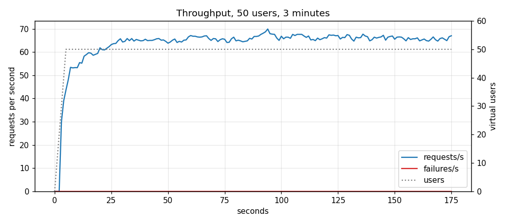
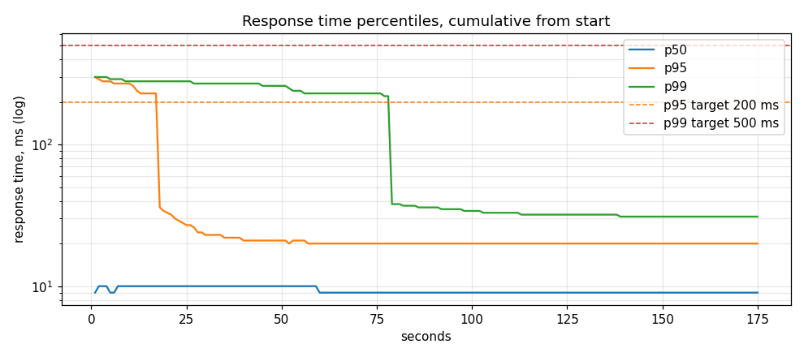

# Performance Audit (CP3)

Concurrency control, query audit and load test for `Checkpoint_3_Concurrency_and_Performance.pdf`. Design rationale lives in [DESIGN.md](DESIGN.md#concurrency); this document is the evidence.

| CP3 target (§2.3) | Result |
|---|---|
| 50 virtual users, read/write mix, 3 minutes | 50 users, 11,686 requests, 14 endpoints |
| Stable throughput | 65.2 req/s average, 61 to 70 req/s after ramp-up |
| p95 < 200 ms | **20 ms** |
| p99 < 500 ms | **31 ms** |
| Errors < 1% | **0 of 11,686** |

Run on 2026-10-25, after the per-table booking lock: one uvicorn worker, PostgreSQL 15 and MongoDB 6 in Docker, 16-core laptop, load generator on the same machine. Raw data: [perf/stats.csv](perf/stats.csv), [perf/stats_history.csv](perf/stats_history.csv).

---

## Concurrency

```bash
pytest tests/test_concurrency.py tests/test_orders.py -v -s
```

| Race | Mechanism | Test | Result |
|---|---|---|---|
| 20 customers book one table for one window | `EXCLUDE` constraint | `test_twenty_customers_one_table_exactly_one_booking` | 1 × `201`, 19 × `409`, 1 row |
| The same race, 10 times in a row | `EXCLUDE` + per-table row lock | `test_repeated_booking_races_never_fail_with_500` | 1 × `201`, 19 × `409` every time, never `500` |
| 20 edits of one reservation from the same version | Optimistic, `xmin` | `test_twenty_concurrent_edits_exactly_one_wins` | 1 × `200`, 14 × `409`, 5 × `412` |
| 6 clients add a guest, read-modify-write, retry on conflict | Optimistic, `xmin` | `test_read_modify_write_loses_no_update` | `party_size` 2 → 8, no increment lost |
| 20 staff move one order `placed → preparing` | `SELECT ... FOR UPDATE` | `test_twenty_identical_changes_exactly_one_applies` | 1 × `200`, 19 × `409` |
| 10 × `ready` against 10 × `cancelled` | `SELECT ... FOR UPDATE` | `test_racing_ready_and_cancel_one_wins` | 1 × `200`, 19 × `409`, final status is the winner's |

Each request runs in its own session on its own pooled connection, so the transactions overlap inside PostgreSQL. A transaction here lasts about a millisecond, so requests that merely start together rarely overlap. The edit and order races therefore hold the row lock in the test until every request is waiting on it, then release it: every request has read before any can write, on every run.

**The tests fail without the mechanism.** Same tests, mechanism removed:

| Removed | Result |
|---|---|
| `version_id_col` on the model | 15 of 20 edits return `200`: 14 lost updates. Read-modify-write loses increments |
| `.with_for_update()` in `advance_status` | 15 of 20 identical transitions return `200`; ready and cancelled both "win" |

`409` and `412` (CP3 §2.1 Option A) are both reachable. `412`: the `If-Match` sent is already stale when the request reads the row. `409`: the row changed between this request's read and its `UPDATE ... WHERE xmin = :version`. Both mean "re-read and retry". `traffic.py` does exactly that and counts it as a conflict, not a failure.

The CP2 proof still holds alongside: `python scripts/traffic.py --mode concurrent --burst 20` against a running server, 1 × `201`, 19 × `409`.

### Finding: concurrent bookings could deadlock

Racing 20 different customers for one table showed a fault the single-user CP2 test never did: about one race in six, one request got a `500`. Two `INSERT`s for overlapping windows each found the other's uncommitted row while the `EXCLUDE` constraint was checked and waited for each other; PostgreSQL aborted one with `40P01 deadlock_detected` after its 1 s `deadlock_timeout`. Present since CP1.

| Version | Result |
|---|---|
| No handling | 500 in about 1 race in 6; the repeated-race test failed 2 runs in 3 |
| Retry the aborted insert, up to 5 times (#19) | 0 failures in 440 races on a warm database; still failed after a restart, when retries ran out, and each deadlock cost 1 s |
| Read the table row `FOR NO KEY UPDATE` first (#20) | 0 failures in 440 races on a freshly restarted database; no deadlock possible, so no 1 s waits |

The lock only queues bookings for the same table; the constraint still decides who wins. Rationale: [DESIGN.md](DESIGN.md#bookings-exclusion-constraint).

---

## Query audit

```bash
pytest tests/test_query_budget.py -v
```

Every statement the app sends is captured from the engine. A list endpoint passes when 1 row and 5 rows cost the same number of statements, and the column assertions fail if a projection regresses.

| Endpoint | SQL per request | Selected | Before CP3 |
|---|---|---|---|
| `GET /restaurants` | 2: count, page | 6 summary columns | unchanged |
| `GET /restaurants/{id}` | 1 | 8 response columns, not `owner_id` | whole entity |
| `GET /restaurants/{id}/availability` | **1**: tables + `NOT EXISTS` | 4 columns | 2, and the probe scanned instead of using an index (below) |
| `GET /reservations` | 2: caller, list `JOIN restaurants` | response columns + `restaurant_name` | the page then fetched `GET /restaurants/{id}` once per restaurant: 1 + R HTTP requests |
| `GET /orders` | 2: caller, list `JOIN` + `GROUP BY` | summary columns, `count(order_items.id)` | did not exist |
| `GET /orders/{id}` | 3: caller, order, items (`selectin`) | | unchanged |
| Caller lookup, every authenticated request | 1 | profile columns, **not `password_hash`** | whole user row including the hash |
| `POST /auth/login` | 1 | `id`, `password_hash`, `role`, `is_active` | whole user row |

"Caller" is the user lookup behind `CurrentUser`. It re-reads the user on every request so a disabled account loses access at once.

### Availability: same answer, the constraint's index

The overlap probe was `starts_at < :end AND ends_at > :start`. No index serves that, so PostgreSQL fetched every reservation of each table and filtered. It is now written exactly as the `EXCLUDE` constraint is, so the probe is an index lookup on `no_double_booking`:

```sql
-- the old predicate: 1.66 ms
Bitmap Heap Scan on reservations r
  Filter: ((starts_at < '...') AND (ends_at > '...'))
  Rows Removed by Filter: 70
  ->  Bitmap Index Scan on no_double_booking
        Index Cond: (restaurant_table_id = t.id)

-- after: 0.07 ms
Index Scan using no_double_booking on reservations r
  Index Cond: ((restaurant_table_id = t.id) AND
               (tstzrange(starts_at, ends_at, '[)') && tstzrange('...', '...', '[)')))
```

The status is a literal (`status <> 'cancelled'`), not a bound parameter. With a parameter, a generic plan cannot prove the partial index applies and falls back to a sequential scan of all 21,000 reservations (3.9 ms). `test_availability_matches_the_constraint` pins the semantics: back-to-back is free, any overlap is taken.

### MongoDB: index order matches the sort

`GET /products` filters on equality fields and sorts by `name`. With `name` last in the index the documents come back already ordered:

| Query | Before | After |
|---|---|---|
| Menu: `restaurant_id`, `is_available`, sort `name` | `IXSCAN` → `FETCH` → in-memory `SORT` | `IXSCAN {restaurant_id, is_available, name}`, no `SORT` |
| Catalogue: `is_available`, sort `name`, limit 20 | `COLLSCAN`: 800 documents read, then `SORT` | `IXSCAN {is_available, name}`: 20 documents read |

Both endpoints already projected to the summary fields; `description` and `attributes` stay on disk.

---

## Load test

```bash
pip install -r loadtest/requirements.txt
uvicorn app.main:app --port 8000          # one worker
locust -f loadtest/locustfile.py --headless -u 50 -r 10 -t 3m \
    --host http://localhost:8000 --csv loadtest/results/run
python loadtest/charts.py loadtest/results/run docs/perf
```

Locust exits `1` if any CP3 target is missed, so the run is a pass/fail check, not a reading.

Each virtual user signs in as a different seeded customer, then loops with 0.5 to 1.5 s between actions: search restaurants, open a restaurant and its menu, browse the catalogue, check availability, book, list and edit its bookings (`PATCH` with `If-Match`), cancel, order, list its orders. About 18% of requests write. Users never share a booking or a time window, so any `409` or `412` would be a real fault: there were none.





The percentiles are cumulative from the start. The 50 sign-ins at ramp-up take 270 ms each (bcrypt, by design) and keep the cumulative p99 above 200 ms until they fall below 1% of all requests at about 80 s.

| Endpoint | Requests | Failures | p50 ms | p95 ms | p99 ms | req/s |
|---|--:|--:|--:|--:|--:|--:|
| `POST /api/v1/auth/login` | 50 | 0 | 270 | 290 | 300 | 0.3 |
| `GET /api/v1/orders` | 418 | 0 | 13 | 18 | 21 | 2.3 |
| `POST /api/v1/orders` | 448 | 0 | 24 | 33 | 36 | 2.5 |
| `GET /api/v1/products` | 838 | 0 | 8 | 14 | 18 | 4.7 |
| `GET /api/v1/products?restaurant_id` | 1,714 | 0 | 6 | 11 | 13 | 9.6 |
| `GET /api/v1/reservations` | 837 | 0 | 12 | 17 | 19 | 4.7 |
| `POST /api/v1/reservations` | 860 | 0 | 15 | 21 | 24 | 4.8 |
| `DELETE /api/v1/reservations/{id}` | 328 | 0 | 17 | 23 | 28 | 1.8 |
| `GET /api/v1/reservations/{id}` | 385 | 0 | 10 | 14 | 17 | 2.1 |
| `PATCH /api/v1/reservations/{id}` | 385 | 0 | 12 | 20 | 22 | 2.1 |
| `GET /api/v1/restaurants` | 50 | 0 | 8 | 16 | 16 | 0.3 |
| `GET /api/v1/restaurants/{id}` | 1,715 | 0 | 8 | 12 | 15 | 9.6 |
| `GET /api/v1/restaurants/{id}/availability` | 2,060 | 0 | 9 | 14 | 16 | 11.5 |
| `GET /api/v1/restaurants?city` | 1,598 | 0 | 10 | 14 | 16 | 8.9 |
| **Aggregated** | 11,686 | 0 | 9 | 20 | 31 | 65.2 |

### Finding: sign-in froze the server

bcrypt takes about 0.2 s of CPU per call. `verify_password` ran it on the event loop, and one uvicorn worker has one loop: while a password was checked, no other request moved. Measured with 20 customers signing in at once while other requests ran:

| | 20 sign-ins take | Other requests p50 | p95 | max |
|---|--:|--:|--:|--:|
| Before: bcrypt on the event loop | 4.1 s | 3,430 ms | 3,900 ms | 3,960 ms |
| bcrypt in a worker thread | 1.1 s | 9 ms | 230 ms | 270 ms |
| + connection released before bcrypt | 1.1 s | 8 ms | 19 to 68 ms | 47 to 103 ms |

The fix is in `app/security.py` (`run_in_threadpool`; bcrypt releases the GIL while hashing) and `app/routers/auth.py` (the login transaction ends before the hash check, so 20 sign-ins no longer hold 15 of the pool's connections idle). Without it, the 3-minute run still passes, because 50 sign-ins are 0.4% of requests. A sign-in burst, such as everyone opening the app at lunch, would not.

---

## Limits of this audit

- One machine runs the API, both databases and Locust. Absolute numbers are this laptop's; the comparisons are like for like.
- One uvicorn worker, as the CP2 migration phase is per process ([DESIGN.md](DESIGN.md#phases-change-at-runtime-not-by-redeploy)).
- Bookings are spread over far-future dates so users never collide. Contention is proven by the concurrency tests, not by the load test.
